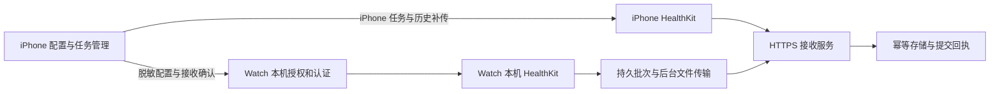
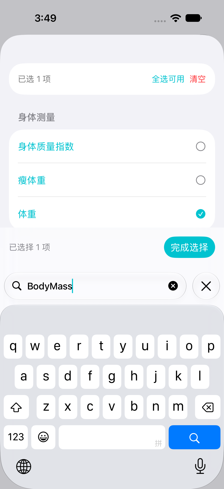
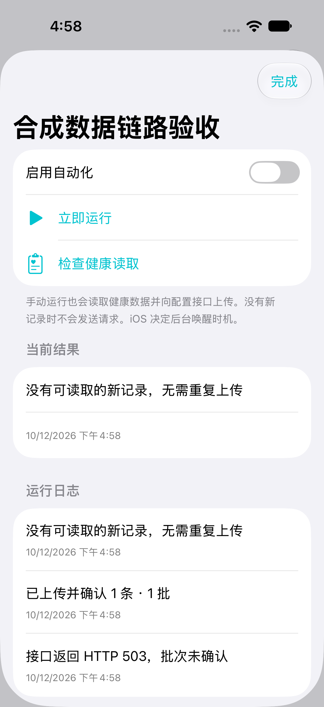

# HealthRelay

An open-source iPhone and Apple Watch app for configurable Apple Health exports. Swift-first; bring your own HTTPS endpoint.

用配置建立健康数据自动化任务：选择指标、来源、单位、日期范围、明细或汇总、执行条件和接收接口。iPhone 负责配置、完整历史导出与补传；Watch 可接收任务，读取手表本机数据并直接上传。任务启用后由数据变化及系统执行机会触发，提醒是独立可选功能。

**当前状态（2026-10-13）：iPhone 通用自动化和 Watch companion 已实现并整合。iPhone 多种上传、前台定时和 Shortcuts 系统时间触发有真机证据；Watch 后台文件上传有模拟器证据。自然后台失败恢复、Watch 真机双端链路和长期可靠性仍待验收，目前不能完整取代 Health Auto Export（HEA）。**

## 当前进展与能力

| 能力 | 已实现 | 验收边界 |
| --- | --- | --- |
| 通用任务配置 | 新建/编辑/复制/删除、指标混选、来源/单位/日期范围、HTTPS/Header/认证、导入导出 | Core 与原生模拟器保存/重启通过；文件导出脱敏，认证存本机 Keychain |
| 健康数据读取 | 数量、分类、关联明细与锻炼摘要；按类型分页、anchor、新增/删除 | iPhone SDNN、RMSSD、步数、睡眠已有真实样本上传证据，不能推定全部类型已验收 |
| 导出与汇总 | 原生 JSON/CSV/Markdown，20 项 HEA v2 映射和 HEA multipart CSV；每指标独立汇总、日历窗口、迟到/删除修正、跨午夜睡眠 | HEA JSON/CSV 接收回执通过；真实 HEA 文件字段、百分比及汇总值仍待逐项对照 |
| 历史补传与恢复 | 独立固定日期 job、公平串行队列、继续/取消、持久待上传批次、退避与确认后提交游标 | iPhone 补传真机通过；本地及模拟器已验证失败重试、相同批次/正文、无变化不再上传 |
| iPhone 自动运行 | HealthKit 变化、前台补跑/间隔检查、BGTask、后台 AppIntent、Shortcuts 时间触发 | 真机前台间隔及 App 未在前台时的 Shortcuts 自动上传通过；自然后台恢复仍待验收 |
| iPhone 后台生命周期 | 启动阶段注册 Observer、处理结束/到期才释放回调、受保护配置解锁后重载、到期申请恢复机会 | 原生生命周期测试及真机启动注册诊断通过；不等同于锁屏持续上传 |
| 可选提醒 | 每小时/每天/指定星期，本地通知及“打开并同步”入口 | 真机自然送达通过；通知动作、清理和冷/热启动交互待完整验收 |
| Watch companion | iPhone 配置同步、执行设备归属、Watch 本机授权/认证/启停、HealthKit 读取、系统后台文件上传、精确回执确认 | 双平台构建、Core、Watch 模拟器上传及重启后不重复发送通过；真机配对同步、读取、自然唤醒和耗电待验收 |

目录包含 121 个数量、72 个分类、2 个关联标识符及锻炼配置，按平台系统版本检查可用性；目录覆盖不等于全部对象均可读取或已验收。**HEA v1、锻炼路线/关联时序及特殊对象读取尚未开放执行**，不支持的组合会阻止运行并说明原因。HEA v2 只支持[显式映射](packages/HealthRelayCore/Sources/HealthRelayCore/HEAEncoder.swift)，删除事件须明确选择拒绝或跳过。

## 为什么做 Watch App

iPhone 锁屏时，HealthKit 与受保护文件的读取会受限制；Watch 上产生的数据还可能需要等待同步到手机。佩戴并解锁的 Watch 在获得系统执行机会时，可以读取本机可访问的新记录，直接上传到同一个接收服务，减少这两段等待。

Watch 是近期数据的另一个执行端。它不拥有 iPhone 的全部历史数据库，也不能绕过健康授权、网络、电量或 watchOS 调度限制。熄屏与锁定不同，摘表或重启后的锁定仍会影响读取；“每 30 分钟”是期望最小间隔，不是上传保证，更不是传感器采样频率。



每个任务只选择一个执行设备。切换设备会停用任务，anchor 不跨设备迁移；从 Watch 切回 iPhone，需要同步移除并等待 Watch 确认，防止两端同时执行。服务端仍须按记录身份去重，不能直接把两端步数/能量相加。

## 使用方式

### iPhone

1. 新建任务，选择指标、来源、日期范围和导出格式，填写最终 HTTPS 接收地址与认证。
2. 保存任务，在运行页完成健康授权并启用。可先用“检查读取”核对数据，再运行一次查看回执。
3. 按需要启用数据变化、回到前台或定期检查；无新数据时不发送空请求。每天特定时间可使用系统 Shortcuts 的“运行健康导出”个人自动化。
4. 大段历史导出使用独立补传任务；查看活动日志确认 pending、失败原因和确认结果。

### Apple Watch

1. 在配对设备安装并打开 HealthRelay；在 iPhone 编辑任务，选择 Apple Watch 为执行设备。
2. 点击“同步 Watch 配置”，等待状态从排队变为 Watch 已接收。同步后的任务默认关闭。
3. 在 Watch 单独填写所需认证、授权并启用。iPhone 的认证值和 Keychain 引用不会通过配置同步传给 Watch。
4. 在 Watch 运行一次并查看结果。“已排队”表示交给系统传输，只有有效回执才推进游标。有未确认批次时，先重试完成或在 Watch 明确取消，再改接口、数据规则或移除任务。

Watch 接口必须是直接接收 POST 的最终 HTTPS 地址。系统后台 URLSession 会跟随重定向；当前实现会拒绝确认发生重定向的响应，但不能阻止系统已转发请求。详见[Watch 实现与限制](docs/implementation-watch.md)。

## 开发与验证

要求 Xcode 27 / Swift 6，最低 iOS 18、watchOS 11。打开 `ios/HealthRelay.xcodeproj`，使用 `HealthRelay` 或 `HealthRelayWatch` scheme。真机使用自己的签名 Team，启用 HealthKit 与后台读取能力；设备标识和签名配置只留本机。

```sh
swift test --package-path packages/HealthRelayCore
node --test tests/cloudflare/worker.test.mjs
python3 scripts/generate_xcode_project.py
xcodebuild -project ios/HealthRelay.xcodeproj -scheme HealthRelay \
  -destination 'generic/platform=iOS Simulator' CODE_SIGNING_ALLOWED=NO build
xcodebuild -project ios/HealthRelay.xcodeproj -scheme HealthRelayWatch \
  -destination 'generic/platform=watchOS Simulator' CODE_SIGNING_ALLOWED=NO build
```

组合构建使用 `-destination`，不要全局指定 `-sdk iphonesimulator` 覆盖 Watch 依赖的 SDK。`CODE_SIGNING_ALLOWED=NO` 适用于编译检查；Watch 模拟器运行涉及 Keychain 时需本地签名（`CODE_SIGNING_ALLOWED=YES CODE_SIGN_IDENTITY=-`）。原生测试选择具体 iPhone 模拟器运行 `HealthRelay` scheme，Watch 生命周期测试选择独立 watchOS 模拟器运行 `HealthRelayWatch` scheme 的 `HealthRelayWatchTests`；涉及 HTTPS 的 UI 用例先按[执行验收步骤](docs/implementation-execution.md)启动本机合成接收器。

本次合并回归：Core 86 项、接收器 8 项、iPhone 生命周期 8 项、Watch 原生 9 项通过；5 个 iPhone UI 场景完成复核，提醒表单定位修正后重跑通过。iPhone + Watch 模拟器组合构建及双平台 Release 真机目标编译通过；Release 检查未签名、未安装，不算真机运行验收。2 项可选外网集成默认跳过。外网集成须另行提供明确授权的私有验收配置；默认测试不会读取凭据或上传真实健康数据。

历史真机证据包括原生明细、HEA JSON/CSV、独立补传和持续前台定时；10 月 13 日 15:12，HealthRelay 未在前台时由 Shortcuts 系统时间触发，2 条/2 批获提交回执。17:07–17:24 自然后台观察中没有新上传尝试，一次 503 故障未被触发，已清除，**未获得自动失败恢复通过证据**。Watch 模拟器证明后台 URLSession 与回执/重启通路，尚不证明真机自然唤醒。

### 使用 iPhone Use 进行 AI 真机调试

项目的 AI 真机 UI 验收使用 **iPhone Use 插件（PUA，Phone Use Agent）**。它通过 MCP → 本机 PUA/WDA 客户端 → USB → iPhone WebDriverAgent Runner/XCTest 操作界面。它是开发工具，不是 App 运行或自动同步的依赖；Core 测试、Xcode 构建与 XCUITest 也能独立执行。

1. 在 AI 宿主安装并启用 iPhone Use 插件；Mac 安装匹配设备系统的 Xcode。连接 iPhone，完成信任、开发者模式和自己的 Apple 开发签名。
2. 先调用 `pua_setup(action="status")`。已有配置/构建时复用；缺少服务才 `start`。首次配置按插件的 `doctor/discover → fetch → configure → build → start` 处理缺项；设备 UDID、Team ID 和 Runner bundle ID 使用自己的本机配置。
3. 服务可用后调用 `pua_ready(recover=true, screenshot=false)`，取得当前会话 `ready=true` 再操作。Runner 图标、构建成功或端口开放都不能替代 READY；同一会话通道正常时不用每步重建。
4. 用 Xcode 或 `xcrun devicectl` 构建/安装 HealthRelay，再用 `pua_launch_app`、`pua_tap`、`pua_type_text`、`pua_swipe` 操作真实界面；下一步需要信息时读取控件树或截图。定位异常先看实际截图，通道故障先恢复 READY。
5. 核对关键结果：配置保存/重启、权限、任务状态、运行来源/时间、pending 与服务端批次 ID、正文摘要、提交回执及去重结果。HTTP 200 或工具返回 ok 不能单独作为同步成功证据。

后台验收时先让 App 离开前台，再从测试接收端元数据与系统日志观察；反复打开 App 会引入前台补跑，不能据此声称自然唤醒通过。DEBUG 启动参数 `--diagnose-background` 配合 `scripts/check_background_startup.py` 只核对 Observer 启动注册顺序。

密码、验证码、Face ID 和设备解锁由使用者本人完成。手机锁定或认证接管期间暂停操作，完成后重新观察；不要把认证或个人数据写进日志/Git。调试材料放在忽略目录 `private-artifacts/`，只使用隔离测试接口。iPhone Use 不直接控制 Apple Watch；Watch 使用 Xcode、watchOS 模拟器及真实配对设备分别验收。

## 后续 TODO（按优先级）

- [ ] **P0 无人干预可靠性**：iPhone 自然 HealthKit/BGTask 唤醒、锁屏/解锁、503→200 自动续传，核对同批次/相同正文/仅提交一次；补上断网、系统到期和长期挂起场景。
- [ ] **P0 Watch 真机闭环**：iPhone→Watch 配置及接收确认、本机认证/健康读取、手机锁屏时的自然上传、断网恢复、配置更新/删除、执行设备切换、延迟回执；至少一个日夜周期记录延迟与耗电。
- [ ] **P1 数据与 HEA 对照**：真实 HEA JSON/CSV 字段和百分比尺度、HealthKit 汇总数值、多来源与跨午夜睡眠；扩展当前 20 项映射。HEA v1 仍未支持。
- [ ] **P1 专用数据读取**：锻炼路线/关联时序、Activity Summary/Characteristics、ECG/Audiogram/Series、State of Mind/Medication；临床/受限类型单独评估接入条件。
- [ ] **P1 通知完整验收**：通知动作的冷/热启动、与前台补跑并发、停用/删除后的提醒清理。
- [ ] **P2 配置与生态**：批量管理、HEA 配置迁移、通过深链创建任务、自动备份恢复、多目的地适配、桌面查询/MCP、Widgets。当前 AppIntent 仅运行已有任务。

常用的单一 HTTPS 导出已有实现基础；只有所需类型、格式与具体设备场景分别通过后，才适合替换对应 HEA 工作流。HEA 的历史差距盘点是实现前基线，最新状态以本 README 和[能力表](docs/capabilities.md)为准。

## 界面

以下为 iOS 27 模拟器真实运行截图，任务与接口均为合成验收配置。

  

 

## 设计与实现记录

- [Watch companion：配置、上传与真机验收计划](docs/implementation-watch.md)
- [后台生命周期与失败恢复](docs/implementation-background.md)
- [定时、快捷指令与提醒验收](docs/implementation-scheduling.md)
- [自动化核心实现与验收](docs/implementation-automation-core.md)
- [导出执行实现与验收](docs/implementation-execution.md)
- [配置阶段历史记录](docs/implementation-configuration.md)
- [能力覆盖与验收](docs/capabilities.md)
- [配置与上传协议](docs/contracts.md)
- [技术设计](docs/design.md)与[可选 Docker 自部署](docs/self-hosting.md)
- [HEA 实现前差距盘点](docs/hea-automation-gap-audit-2026-10-12.md)与[公开依据](docs/research.md)
- [SDK 27 标识符清单](catalog/sdk-27-inventory.json)：覆盖盘点，不表示全部已实现

示例：[多指标明细](examples/task.raw.json)、[日汇总](examples/task.daily.json)、[混合汇总](examples/task.mixed-aggregate.json)、[上传批次](examples/batch.json)、[提交回执](examples/receipt.json)。示例均为合成数据，不是 HEA 自身配置文件。

## 技术栈与开源边界

Swift 6、SwiftUI、HealthKit、Keychain、URLSession、BackgroundTasks、AppIntents、WatchConnectivity 与 WatchKit，无第三方 App 运行时依赖。两端复用 `HealthRelayCore` 配置、编码、持久批次和确认协议；iPhone 使用普通 URLSession，Watch 使用系统后台文件传输。配置与同步状态用受保护 JSON 原子保存，每任务最多一个未确认批次，回执有效后才推进 anchor。

接收端可使用已有 Cloudflare/飞书服务或自己的 HTTPS 服务；Go 服务、Docker、iPhone Use 均不是运行前提。飞书签名、Bot 和看板属于下游应用。

独立实现公开功能与交互语义，不包含第三方二进制、反编译源码或素材，不使用 Collar_watch 的非商业许可源码。贡献仅提交合成样例，不提交真实健康导出、凭据、设备身份或私人日志。

MIT License。本项目与 Health Auto Export / HealthyApps 无隶属关系。
