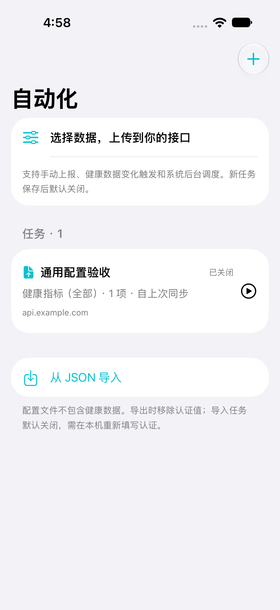
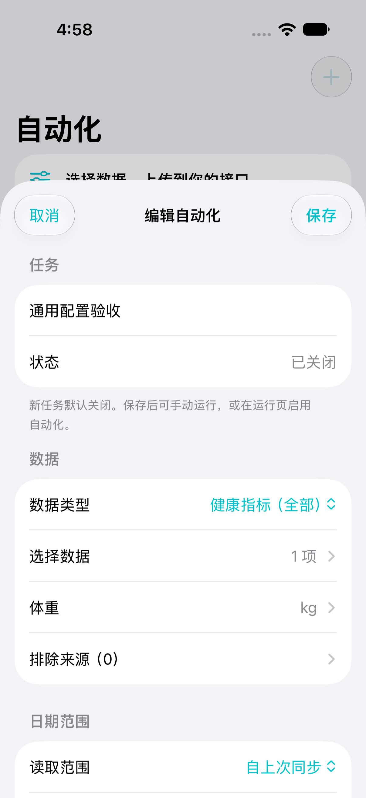
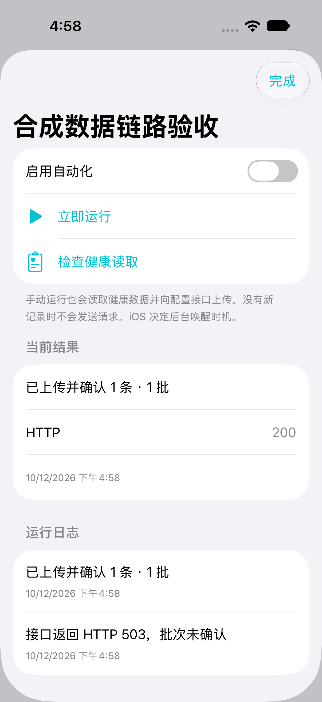
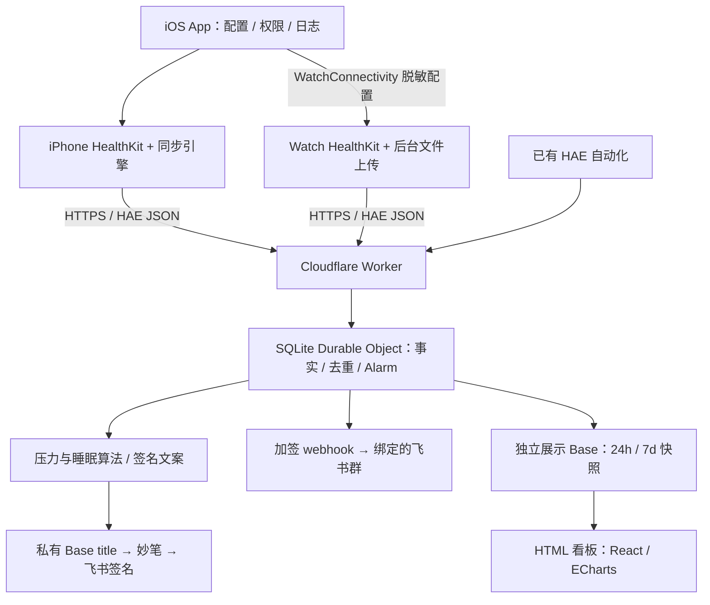
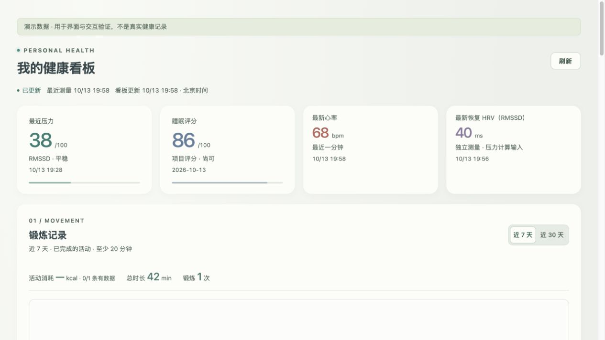

# HealthRelay

**在 iOS App 中配置健康数据自动化，让 iPhone 和 Apple Watch 把数据上传到你自己的服务。**

项目先在 iPhone 上跑通「配置任务 → 读取 Apple 健康 → 导出上传 → 失败重试」，逐项对齐 Health Auto Export（下文简称 HAE）的常用流程，再把适合的任务交给 Watch：在手表获得 HealthKit 数据变化通知或系统执行机会时，读取本机数据并直接上报，减少等待数据同步到手机的时间。

你可以选择指标、来源、时间范围、汇总粒度、执行条件和 HTTPS 接口。仓库也提供一套从 `watch_monitor` 迁入的下游服务：**Cloudflare 存储与计算 → 飞书动态签名 / 群消息 → HTML 健康看板**。

### iOS 界面

以下是 App 在模拟器中的实际界面，使用合成任务和示例接口，无个人健康数据。

<p>
  
  
  
</p>

### 当前做到哪里

- **iPhone**：任务配置、HealthKit 读取、原生 JSON / CSV / Markdown、部分 HAE JSON / CSV、历史补传、持久重试和快捷指令入口已有实现。先在 iPhone 完成所需指标的实际对照，再切换执行设备。
- **Watch**：已实现配置同步、本机授权与认证、数据读取、后台文件上传和回执处理；真机配对、自然唤醒与长期可靠性仍待验收。
- **下游服务**：五流接收、SQLite 存储、确定性状态算法、签名发布、加签群卡和 HTML 看板已迁入；附五份可导入的 HealthRelay 配置及完整五流配置说明。

目前尚未完整替代 HAE。锻炼与扩展 HAE JSON 已实现；本轮按实机文件修正了中文健康指标 CSV 宽表（106 项数量指标与睡眠），并保留旧待发送批次的重试入口。真实运动数据行、CSV 跨指标整包与 REST 传输、两端自然后台连续运行仍待验收，详见[HEA 对照记录](docs/implementation-hea.md)。30 分钟等配置表示期望最小执行间隔，实际后台时机由系统决定。详见[能力表](docs/capabilities.md)和[迁移验收](docs/service-migration.md)。

## 当前架构



下图为迁入 HTML 看板的本地合成预览：



App 使用 Swift / SwiftUI / HealthKit，共享 `HealthRelayCore` 配置、编码与重试逻辑。每个任务由一个设备执行；认证保留在各设备 Keychain。下游以 Cloudflare 为事实存储，群 webhook 与签名 Base 各自发布；HTML 只读取展示副本。iPhone Use 是开发调试工具，不参与日常运行。

```text
packages/HealthRelayCore/       配置、编码、增量游标、重试与回执
shared/                        两端复用的 HealthKit 与后台生命周期逻辑
ios/                           iPhone App、Xcode 工程与原生测试
watch/                         Watch companion
integrations/hae-webhook/       Cloudflare 接收、存储、算法与飞书发布
  dashboard-app/               HTML 模板、前端、构建和脱敏预览
examples/watch-monitor/        迁移后的五流说明与五份可导入配置
tests/                         隔离验收接收器和合成夹具
scripts/                       工程生成、调试及公开文件检查
docs/                          架构、使用、调试和实现记录
```

## 文档

| 想做什么 | 从这里开始 |
| --- | --- |
| 理解两端与服务的数据流 | [架构与边界](docs/architecture.md) |
| 使用原有五条自动化规则 | [自动化配置迁移](docs/automation-profile.md) |
| 部署 Cloudflare、绑定群 webhook、启用签名 | [服务部署与飞书接入](docs/services.md) |
| 理解自动签名、压力与睡眠计算 | [算法与发布规则](docs/signature-algorithm.md) |
| 生成、预览、发布 HTML 看板 | [看板开发说明](integrations/hae-webhook/dashboard-app/README.md) |
| 用 iPhone Use 调试真机 | [iPhone Use 调试](docs/debugging-iphone-use.md) |
| 查看协议、实现记录与尚未验收的能力 | [完整文档目录](docs/README.md) |

## 开始使用与开发

App 要求 Xcode 27 / Swift 6，最低 iOS 18、watchOS 11；具体指标按系统可用性检查。打开 `ios/HealthRelay.xcodeproj`，选择 `HealthRelay` 或 `HealthRelayWatch` scheme，真机使用自己的签名 Team。

在 iPhone 导入[任务示例](examples/watch-monitor/)，替换 `health.example.com`，在本机填写 `X-API-Key`，选择数据来源并授权。先手动运行，核对 App 日志和服务端入库结果，再启用自动化。导入任务默认关闭。Watch 的认证需在 Watch 重新绑定，配置同步不传递 iPhone 密钥。

```sh
# App 核心与隔离接收器
swift test --package-path packages/HealthRelayCore
node --test tests/cloudflare/worker.test.mjs

# Cloudflare 服务（Node.js 22.13+；全程合成测试数据）
npm --prefix integrations/hae-webhook ci --ignore-scripts
npm --prefix integrations/hae-webhook test
npm --prefix integrations/hae-webhook run test:contract  # 需要 Swift
npm --prefix integrations/hae-webhook run test:runtime

# HTML 看板：本地预览不需要飞书账号
npm --prefix integrations/hae-webhook/dashboard-app ci --ignore-scripts
npm --prefix integrations/hae-webhook/dashboard-app run preview
```

真机 UI 调试采用 **iPhone Use**：先检查并启动 PUA 服务，再取得 READY，最后操作 App 并核对设备和服务端证据。完整步骤见[调试文档](docs/debugging-iphone-use.md)。

## 隐私与开源

公开仓库只保存代码、脱敏配置和合成数据。API key、webhook、签名 secret、Base / 文档资源 ID、Magic 授权码及健康导出保留在本机忽略文件或 Cloudflare Secrets；发布后的带授权 HTML 也不得提交。提交前运行 `python3 scripts/check_public_artifacts.py`，并人工检查截图和暂存内容。

本次迁移复制了可运行的服务代码与任务规则；原生产服务、云端数据和真实群绑定未被切换。[迁移记录](docs/service-migration.md)列出来源、验证与差距。

MIT License。HealthRelay 与 Health Auto Export / HealthyApps 无隶属关系，不包含其二进制、反编译实现或素材。
