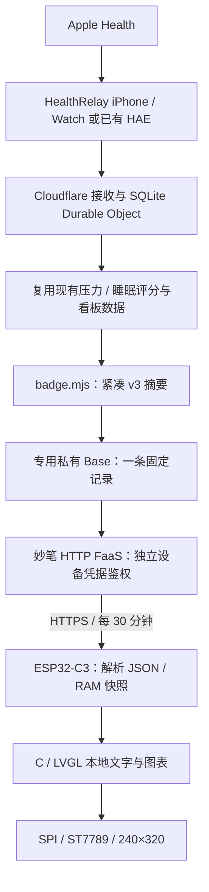

# AI Passport Wi-Fi 健康工卡

把 FoloToy AI Passport 的头像／名牌应用替换为健康看板。工卡连家里 Wi-Fi 或 iPhone 热点，每 30 分钟读取一次健康摘要，不需要电脑持续运行。

本文提供一条部署链路：**HealthRelay 服务 → 专用私有飞书 Base 缓存 → 妙笔只读 HTTP FaaS → 工卡本地 LVGL**。本仓库只包含通用源码、占位配置和合成测试，不包含个人域名、生产资源坐标、健康导出或设备凭据。

## 数据流与渲染



工卡发送普通 HTTPS GET，请求头为 `X-API-Key`；它不登录飞书，不持有飞书 OAuth、应用 secret 或 Cloudflare 管理凭据。妙笔是此方案的函数执行平台，通过其已授权的 Base 能力读取固定记录。Cloudflare 主动更新 Base，读取函数不需要再请求 Cloudflare。

工卡不运行浏览器，也不下载 HTML 或截图。`main/health_main.c` 创建五页 LVGL 对象，`health_model.c` 校验并解析小 JSON，`health_network.c` 负责 Wi-Fi、HTTPS、NVS 和配网页；BSP 负责按钮、LCD、背光和电量计。时钟校准后每秒本地更新，HTTP 更新周期独立为 30 分钟。

上游可达性由实际使用网络决定。域名用于寻址和 HTTPS 证书，不保证网络可达；部署后应从工卡实际使用的 Wi-Fi／热点验证公开函数入口。此方案不需要另买 VPS，也不要求单独注册域名。

## 屏幕与操作

| 页面／状态 | 行为 |
| --- | --- |
| 概览 | 最近有效压力、当天睡眠、当天已上传健身和活动；当前日期只显示一次 |
| 压力 | 使用现有评分选择的最近有效结果，标注原测量时间；历史／过期分标 `LAST PRESSURE`；无结果显示 `--` |
| 睡眠 | 最近七晚深睡、核心、REM、清醒、未知分期堆叠图，显示每天时长和当天睡眠得分 |
| 健身 | 当天已结束且已上传的记录、时长、消耗与去重后的运动类型，例如 Running、Swimming；未知类型为 Other |
| 活动 | 当天步数、活动消耗、运动分钟和距离；缺测或冲突保留未知 |
| 时钟 | SNTP 校准的 UTC+8 日期与时间；测量时间、数据日期、同步时间分别展示 |
| 离线 | 保留 RAM 中旧值与原数据日期，显示 `API OFFLINE`／`LAST DATA`；重启后需重新成功取数 |
| 按键 | 上／下短按切页；确定短按刷新，至少间隔 15 秒；确定长按约半秒进入配网 |
| 省电 | 无操作 60 秒关闭背光、暂停 LVGL 定时器；任意功能键只唤醒，下一次按键才操作；配网页保持亮屏 |

息屏时 Wi-Fi、时间维护与后台取数继续，新数据不会自动点亮屏幕。本版未启用 CPU 深睡或动态调频。硬件为 500mAh 电池、CW2017 电量计；尚无完整放电或平均电流实测，不能据此承诺续航小时数。

## 先在本地调试

要求 Node.js 22.13+、Python 3.10+。本地模式不需要 Cloudflare／飞书账号，不读取 `.dev.vars`，所有外部发布请求由 Mock 接管，不会发到真实群、Base 或生产服务。

在仓库根目录运行：

```sh
npm --prefix integrations/hae-webhook ci --ignore-scripts
npm --prefix integrations/hae-webhook run dev:badge
```

另一个终端读取合成结果：

```sh
curl http://127.0.0.1:8788/healthz
curl -H 'X-API-Key: synthetic-device-key' http://127.0.0.1:8788/badge
```

服务仅监听本机回环地址，使用本地 workerd／SQLite 与合成数据，验证接收、评分、投影和私有缓存发布。`synthetic-device-key` 只用于这个合成实例。Ctrl-C 结束后删除临时状态；它不是生产配置，也不供真实健康上传使用。

妙笔读取器的固定记录、鉴权、大小限制、跨日和压力保留规则单独验证：

```sh
node --test integrations/ai-passport-health/miaobi/badge-cache-reader.test.mjs
npm --prefix integrations/hae-webhook run test:badge-runtime
```

需要调试 USB 协议时，可生成合成帧：

```sh
python3 integrations/ai-passport-health/tools/health_bridge.py --demo --output /tmp/badge-demo.json
```

固件准备后的 `tests/test_health_model.c` 验证 v1/v2/v3、睡眠分期、运动类型和离线语义，`tests/test_health_idle.c` 验证息屏与唤醒手势。USB 兼容模式用于未初始化 Wi-Fi 接口的设备；已经配置 Wi-Fi 的工卡忽略 USB 健康帧，避免维护连接覆盖真实数据。**本地 HTTP 调试不改变生产固件的 HTTPS 与证书校验要求。**

## 部署专用私有缓存

先按[服务部署说明](services.md)配置现有 Cloudflare 健康接收服务和手机上传。已有服务更新时，保留 Worker 名称、Durable Object 类／namespace／对象 identity、绑定和现有 secrets，不要用示例配置覆盖生产坐标。

1. 新建专用私有飞书 Base，关闭链接分享和外部访问。创建文本字段 `name`、`payload`、`credential_sha256`，再创建一条固定记录，`name` 可填 `health-badge`。
2. 给自己管理权限，给现有健康同步应用记录编辑权限，给妙笔读取应用只读权限。健康摘要与设备凭据摘要仅写这张专用表，不写组织可读的展示表。
3. 在 Cloudflare 配置现有 `FEISHU_APP_ID`、`FEISHU_APP_SECRET`，并新增下面四项。设备 key 用独立高熵随机值，不复用上传或管理 key。

| 配置 | 内容 |
| --- | --- |
| `BADGE_API_KEY` | 独立工卡只读 key，16–128 个符合初始化工具要求的 ASCII 字符 |
| `BADGE_CACHE_BASE_TOKEN` | 自己的专用 Base token |
| `BADGE_CACHE_TABLE_ID` | 自己的表 ID |
| `BADGE_CACHE_RECORD_ID` | 自己的固定记录 ID |

使用本机 `.dev.vars` 或 `wrangler secret put` 交互填写值，保持忽略状态；不把凭据、部署坐标写入公开 `vars`。四项齐备后，已有发布流程保存小快照并推送专用记录。原 HTML 看板和工卡私有记录独立重试；私有发布失败不重发成功的 HTML 展示记录。

首次启用或协议升级后，可通过现有管理接口 `POST /dashboard-cache/refresh` 生成并发布一次快照。该操作需要管理凭据；工卡 key 无权触发发布、上传或读取完整健康历史。尚无已接收事实时，`/badge` 返回 503；有历史事实但缺少工卡快照的旧部署会在首次读取时初始化一次，后续轮询只读已保存快照。

### 发布妙笔读取函数

在已具备 HTTP FaaS 能力、并被授权读取专用 Base 的妙笔环境中发布读取函数。平台访问权限／发布入口由自己的账号决定，本仓库不提供共享授权码或公共健康服务。

在忽略目录中创建 owner-only JSON，内容仅为自己的部署坐标：

```json
{"base":"example_base","table":"example_table","record":"example_record"}
```

```sh
chmod 600 private-artifacts/badge-cache.json
python3 integrations/ai-passport-health/miaobi/prepare_reader.py \
  --config private-artifacts/badge-cache.json \
  --output private-artifacts/badge-reader.cjs
```

发布生成的 `badge-reader.cjs` 为 HTTP FaaS，并记录自己的 HTTPS 地址。生成器固定 Base／表／记录，读取者不能通过 URL 参数切换目标。函数只接受带 `X-API-Key` 的 GET，以 SHA256 字节做恒定时间比对；8 秒超时，不记录健康正文，返回 `Cache-Control: no-store`。原始设备 key 留在 Cloudflare 和工卡，Base 只保存其 SHA256 校验值。

生成的函数源码带有自己的资源坐标，继续保留在忽略目录。公开的 `miaobi/badge-cache-reader.cjs` 只是占位模板，不能直接读到任何真实数据。

## 固件构建与初始化

硬件要求 FoloToy AI Passport 的 ESP32-C3、8MB Flash、ST7789 240×320 LCD。固件基于 [FoloToy/ai-passport](https://github.com/FoloToy/ai-passport) 的固定 commit `3d685a90bdb96dd8526d84edde1e63fec25b460e`；本仓库保存完整应用补丁，准备脚本从公共上游重建完整源码。

```sh
# HealthRelay 根目录；目标目录必须尚不存在
python3 integrations/ai-passport-health/prepare_firmware.py private-artifacts/badge-source
cd private-artifacts/badge-source
# 按上游说明安装并激活 ESP-IDF 5.5.3，然后执行
./tools/validate.sh --all
```

输出包含验证过的合并镜像、应用镜像、分区表及匹配的 ELF／manifest。首次安装使用完整镜像写入 `0x0`。更新现有设备并保留设置时，先核对新旧分区表完全一致，再只写验证过的应用镜像到应用分区；本布局应用偏移为 `0x10000`，应用镜像不能写入 `0x0`。不需要整片擦除。设备型号、分区或镜像不一致时先停止烧录。

在本机私有文件保存自己的 FaaS 地址和与 `BADGE_API_KEY` 一致的 token：

```json
{"url":"https://badge.example.com/badge","token":"example-replace-with-own-random-device-key"}
```

```sh
chmod 600 /absolute/private-data/badge.json
python3 tools/configure_wifi.py \
  --config /absolute/private-data/badge.json \
  --port /dev/cu.usbmodemXXXX
```

示例 URL 是占位符，初始化时替换为自己发布函数的完整 HTTPS 地址。

USB 只初始化一次接口，工具不回显配置，等待设备持久保存确认。Wi-Fi 和接口凭据保存在普通 NVS，未启用 Flash 加密；不要把 NVS、镜像调试转储或实际私有配置提交到仓库。

### 手机配网与日常使用

1. 长按确定约半秒。手机连接工卡显示的 `Health-XXXX` 临时热点和随机密码。
2. 手动打开 `http://192.168.4.1`，填写家里 Wi-Fi；第二项填写 iPhone 热点名称和密码。
3. 两项都使用 2.4GHz 个人网络。iPhone 打开“允许其他人加入”和“最大兼容性”，提交后让手机恢复正常上网或开启该热点。
4. 工卡取得 IP 后才保存候选配置；45 秒失败则回滚旧配置。成功后校时、验证 HTTPS 证书并拉取数据，显示 `WI-FI ONLINE`。
5. 拔掉 USB。工卡轮流尝试两个网络，失网时每 15 秒重试／轮换；每 30 分钟取数，短按确定可手动刷新。

工卡使用 iPhone 流量时，通过个人热点连接。手机和工卡不需要处于同一局域网；工卡直接连接已部署的读取函数。临时配网热点五分钟后关闭，长按上键可清除网络重新配置并保留接口。

## v3 数据与时间语义

`badge.mjs` 输出 26 个字段的紧凑 ASCII JSON，最大 4093 字节。固件兼容 v1/v2；新增 `sleepWeek`、`workoutTypes`。

- `sleepWeek` 固定七个北京时间日期，每晚含 `date,total,deep,core,rem,awake,unknown`。单位为分钟，`deep + core + rem + unknown = total`，清醒另计；泛睡眠保持未知，缺测或冲突夜留空。
- `workoutTypes` 最多八种去重安全标签，每种最长 24 个 ASCII 字符，超过八种以 More 结尾。
- 压力读取现有评分选中的最近有效结果，保留原时间；不拿趋势均值替代，也不把保存时间当测量时间。RMSSD 和 SDNN 不混用。
- 北京时间跨日后，缓存移动七晚窗口、保留历史压力及其时间，清空当天睡眠得分、健身与活动等待新数据。离线设备继续展示快照原日期。
- `WI-FI ONLINE` 证明成功读取接口，不代表刚得到新的 HealthKit 样本。数据新鲜度仍取决于手机／Watch 的实际上传与服务端评分时机。

## 验证范围

自动检查覆盖投影、跨日、压力保留、睡眠分期、运动类型、鉴权隔离、固定记录访问、持久缓存重试、C 解析与息屏手势，以及固件构建／镜像一致性。

在一台工卡上已确认五页显示、Wi-Fi 取数、自动息屏、按键唤醒和恢复联网。不同硬件、真实家庭网络／热点长时间重连、拔线跨越完整更新周期及完整电池放电应各自验收；宿主机测试和构建不代表这些长期行为已经验证。

固件补丁基于上游 MIT，保留 [FoloToy 原版权声明](../integrations/ai-passport-health/LICENSE.firmware)；HealthRelay 服务与本集成代码沿用仓库 MIT。
