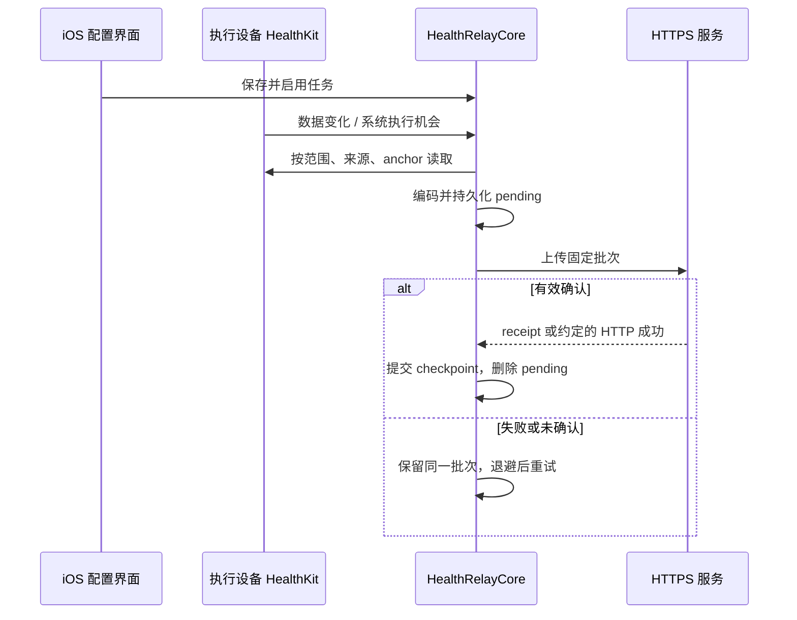

# 架构与运行边界

HealthRelay 将配置、采集和下游展示分开。App 可连接任意兼容 HTTPS 接口；仓库内 Cloudflare 集成是一个可选的单用户接收服务。

## iPhone 与 Watch

`HealthRelayCore` 定义任务、指标目录、原生与 HAE 编码、游标、待上传批次、退避和确认规则。iPhone 负责配置与完整历史读取；Watch 读取手表本机可访问的数据，通过后台 URLSession 文件任务上传。

任务只指定一个执行设备。配置通过 WatchConnectivity 同步，Keychain 值与设备游标不随配置传输。切换设备会停用任务，从 Watch 移回 iPhone 还要确认移除，避免两端同时执行。服务端依然需要记录级去重，多来源数据不能直接相加。

原生 `healthrelay.v1` 可以携带记录身份与删除事件；HAE 兼容格式有明确的映射和删除策略。迁入服务消费 HAE JSON，配置使用 `http2xx` 确认；它不实现 App 的原生批次 receipt 协议。测试接收器 `tests/cloudflare/` 支持 receipt，但不用于生产部署。

## Cloudflare 接收与计算

代码位于 [`integrations/hae-webhook/`](../integrations/hae-webhook/)。可选 gateway 通过 Service Binding 转发到后端。后端鉴权、限制请求体、校验数据流和粒度，再交给 `HEALTH_STORE`。

`HealthStore` 是 SQLite-backed Durable Object，不是 D1。当前所有请求进入 `personal` 对象，因此是一用户一部署。事务提交归一化事实、接收统计、衍生状态、待发布计划和 Alarm；上传成功不代表飞书已发布。

| 部分 | 代码入口 | 责任 |
| --- | --- | --- |
| HTTP 边界 | `worker.mjs` | 路由、密钥、1 MiB 限制、类型和粒度校验 |
| 事实存储 | `series.mjs`、`health-store.mjs` | 35 天窗口、记录去重和修订、事务与 Alarm |
| 健康估算 | `health-indices.mjs`、`health-profile.mjs` | 同来源基线、RMSSD / SDNN 分离、压力和睡眠评分 |
| 文案与历史选择 | `health-signature.mjs`、`pressure-history.mjs` | 有效结果、保留结果、状态文案和时间语义 |
| 群卡 | `health-card.mjs`、`delivery.mjs` | 内容指纹去重、HMAC 加签、webhook 重试 |
| 个性签名 | `miaobi.mjs` | 仅更新指定 Base 记录的 `title` |
| 展示副本 | `dashboard.mjs`、`dashboard-cache.mjs` | 24h / 7d DTO、事件驱动刷新、独立 Base |
| HTML | `dashboard-app/` | React / ECharts、Magic SDK 读取、单文件构建 |

新事实、修订、指标过期、睡眠稳定和北京时间跨日触发重新评估。未变更的重复上传复用快照。签名变化合并 30 秒，两次成功写入至少间隔 2 分钟；群卡合并 1 分钟、至少间隔 5 分钟。看板写入合并约一分钟且至少间隔两分钟，前端可见时每两分钟读取 Base。

## 三条发布边界

- **动态签名**：Worker 用应用凭据更新私有 Base 的 `title`，妙笔读取并呈现在飞书个人签名；代码没有直接修改个人资料的 API。
- **群消息**：每个部署使用一个群自定义机器人的 webhook。机器人所在群就是消息目标；不会监听群消息，也不需要用群 ID 路由。
- **HTML 看板**：后端写入独立展示 Base，页面经 Magic SDK 读取它。页面授权码可被读者提取，只能授予展示副本只读权限；上传密钥与应用 secret 不进入页面。

群 webhook 不支持本项目的幂等键：远端成功而本地确认丢失时可能重复发卡。Base 重写固定记录可收敛，但不承诺跨系统 exactly-once。

## 当前迁移差距

五条 HealthRelay 请求已通过编码到服务的合成契约测试。锻炼摘要使用已合入主线的 HAE v2 编码器；路由和关联曲线另按真实文件验收。HAE 原始记录的删除没有在此后端形成 tombstone 协议；样例选择拒绝删除，不能用跳过删除假装完成同步。

HealthRelay 的心率汇总按已观察到的 HAE 形状不输出 source，HRV 汇总来源为 `HealthRelay`，原始睡眠保留真实来源。它们与原 HAE 的来源标记可能不同，不能自动继承设备基线。夜间压力回退需要来源一致；迁移前须对照来源过滤、数值和基线，当前不自动重写来源。详见[配置迁移](automation-profile.md)。
