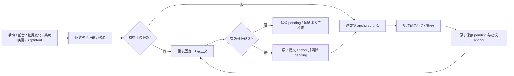

# HealthRelay：通用 Apple Health 自动化配置引擎

2026-10-12。配置与第一版明细执行链路已实现；下文标明当前实现和后续设计。验收状态见 [执行阶段记录](implementation-execution.md)与[能力表](capabilities.md)。

## 1. 产品定义

用户配置读什么、从哪些来源读、读哪个范围、采用什么格式、何时运行、发到哪里。数量、分类、关联记录和锻炼共用任务模型；产品不固定在 HRV、心率或飞书签名几个业务流上。

HEA 是公开功能参照。项目独立实现配置和执行语义，不包含第三方二进制、反编译源码或素材，不把尚未验证的 HEA 内部算法当成事实。

第一阶段只做 iOS App，直接面向用户配置的 HTTPS 接口。Go/Docker 是后续可选接收组件，不是运行前提；签名、Bot、HTML 看板属于下游，见 [自部署边界](self-hosting.md)。

## 2. 当前结构

Swift 6 + SwiftUI，最低 iOS 18，以 Xcode 27 SDK 构建。HealthKit 负责权限、样本、来源和变更；Keychain 保存凭据；URLSession 发送请求；BackgroundTasks 与 AppIntents 调用共同执行器。

```text
ios/HealthRelay/          SwiftUI、HealthKitReader、凭据、生命周期、AppIntent
packages/HealthRelayCore/ 配置/能力校验、记录、编码、SyncJournal、SyncEngine、HTTP
catalog/                  SDK 标识符覆盖盘点
examples/                 合成配置、批次和回执
scripts/                  工程/目录生成、合成 HTTPS 验收辅助工具
tests/cloudflare/         可选隔离验收 Worker，独立存储，不接生产下游
```

首版没有 ORM、外部数据库或服务器依赖。`tasks.json` 保存配置，每任务独立同步 JSON 保存检查点、一个待上传批次和最近 30 条日志；原子写入，iOS 使用完整文件保护。一个未确认批次会阻止继续读下一页，避免无限缓存历史。

SQLite 和文件式后台 URLSession 暂未接入。单批次同步文件适合先验收正确性；后续只有多批次并行、复杂窗口、数据库查询需求明确后，再迁移到事务数据库。

## 3. 目录与读取能力

SDK 清单有 121 个数量、72 个分类、6 个特征和 2 个关联标识符；配置目录另有锻炼条目。这个数量是盘点，不是全部 HealthKit 对象或逐项真机验收。

| 家族 | 当前读取/输出 | 后续工作 |
| --- | --- | --- |
| Quantity | anchored 新增/删除、显式单位映射、UUID/来源/时间 | 类型逐项验收、合法统计 |
| Category | 原始枚举、起止时间、新增/删除 | 各类时长/计数策略 |
| Correlation | 父对象及子记录 | 实际关联样本矩阵 |
| Workout | 核心摘要、事件和已有统计 | 路线、相关时序、子数据分页 |
| Activity Summary / Characteristics | 未接入 | 快照比较，不伪造 anchor |
| ECG / Audiogram / Series / 心情 / 用药 | 未接入 | 专用查询、结构化载荷、版本判断 |
| Clinical / restricted | 未接入 | 先验 entitlement、权限与接入条件 |

数量使用原生 HKUnit 构造器和兼容性检查，不能直接猜字符串；分类保留数值枚举，不按数量处理。关联请求子类型读取权限。来源以 bundle identifier 过滤，排除优先；删除事件仅有 UUID，由接收端忽略未导入的身份。

metadata 当前保留字符串、日期、数字、布尔；无法表示的值列出键名。锻炼摘要不表示路线/曲线已完整导出。

## 4. 一个配置模型，执行前检查能力

`AutomationConfig` 供 UI、文件导入和 AppIntent 共用；`schemaVersion`、任务 ID、保存版本与运行检查点独立。

配置可保存范围广于执行范围。当前只执行 raw 明细；支持原生 JSON、CSV、Markdown 和有限 HEA v2。汇总、HEA v1、路线/时序配置保留但执行前拒绝，并显示原因。SDK 新类型还需要当前系统可用性和运行时 HealthKit 校验。

导入会移除认证值和设备引用、默认禁用，预览后重新绑定凭据；文件不携带健康样本或运行游标。凭据只在请求时从 Keychain 注入，锁定或读取失败不会打印其值。

有待上传批次时阻止编辑配置，以免旧数据被发到新地址。可以明确取消未确认批次再修复配置；取消不推进 anchor，下一次重新读取。名称或开关不改变查询身份；范围、数据、来源、单位或格式变化会建立新查询键。只改目标接口不自动回填旧历史。

## 5. 执行与恢复



同任务运行合并，任务按顺序处理；没有多个重型历史查询同时争用后台预算。默认每页 500 条、编码后最多 1 MiB，配置可调整。本地超限从原 anchor 减小读取页；单条超限报错，不截断。每次执行预算默认 25 秒，页与页之间检查预算/取消，未完成时下次继续；这不是每个底层调用的硬超时。

**首版的进度规则是确认后推进 anchor。** 一页内容、固定批次 ID、建议新 anchor 先保存在同一文件；失败时保留文件，不继续读下一页。收到有效确认后再把建议 anchor 变成提交检查点并清除批次。重启重发相同 ID 与相同正文。服务端已经提交但响应丢失时仍会重发，所以接收端必须幂等。

空页可直接保存新 anchor，没有健康事件就不发空 HTTP。损坏状态不自动重置为空，不覆盖历史进度。运行日志只记录结果、计数、HTTP 与时间，不记录认证或整个健康请求体。lastConfirmedAt 独立记录有效确认；后续空页显示无需重复上传，不误报读取权限问题。

### Since Last Sync

首次以配置时区的日历起点确定历史下界并冻结。以后固定 predicate，使用每类型 anchor 获取 HealthKit 后来保存的新增/删除对象。旧测量时间但后来写入的记录，只要在首次覆盖范围内也能被读到；不是仅看最近 30 分钟。

启动范围以前的数据需要独立回填。日历窗口变化会重新读取重叠历史，改规则、重装、回填也可能重复上传；不能把客户端游标当成服务器去重替代品。

## 6. 上传协议

HTTP POST、HTTPS、固定 `Idempotency-Key`，禁用 URL 缓存并拒绝重定向；不全局关闭 TLS 校验。认证 Header 保存 Keychain 引用。

- `receipt`：HTTP 200/201、匹配 batch ID、committed=true、整批计数相符。
- `http2xx`：接受 2xx 与空响应但排除 202；仅证明接口接受，不能证明入库。

网络失败、408、429、5xx 自动退避；支持 Retry-After 秒值。认证/协议错误、重定向和无效回执保留批次并停止自动重试。413 当前需要人工修复，尚未自动服务端拆批。

原生记录按认证用户、类型和样本 UUID 去重；删除幂等。批次去重、记录与回执推荐在接收端同事务提交。协议和精确边界见 [contracts](contracts.md)。

可选验收 Worker 位于 `tests/cloudflare/`，使用独立 Durable Object SQLite namespace 和测试密钥，不绑定生产存储或飞书。原生批次以固定 ID 与 SHA-256 去重，同事务提交记录和回执；状态接口读一条索引计数记录。它仅用于验收，不是多用户生产接收服务，也不是 App 的必需组件。

HEA v2 当前只支持代码中显式映射的数量和睡眠分段，不保留原生 UUID/完整 metadata，也不表达删除；遇到删除报错。HEA v1 未开放。不能只复用 Header 就宣称 HEA 输出对等。

## 7. 后台、快捷指令与通知

手动运行可执行关闭的任务。自动入口只运行启用任务，并考虑待上传、dirty 状态和最小间隔。Observer 先持久记录 dirty，再调用一次 completion，不等待网络；运行开始消费原 dirty，失败/未完成恢复 dirty，运行中到达的新通知不会被结束动作抹掉。

前台恢复和 BGTask 均调用同一执行器。BGTask 申请最早运行时间，iOS 决定是否和何时唤醒；不能保证每 N 分钟准点。到期取消任务，未确认批次保留。HealthKit、受保护文件和 Keychain 在锁屏时可能不可读；要靠真实设备分别验收。

AppIntent 选择已有任务、打开 App 并调用同一引擎，不另建游标。已构建不等于快捷指令 App 实际调用验收；不能额外提供精准周期后台能力。

失败/成功通知按配置申请权限和投递；它是结果提示，不是调度器。当前 URLSession 为普通 ephemeral session，App 挂起后不承诺请求仍后台持续传输。

## 8. 后续优先级

1. 四类型原生明细真机→隔离 Cloudflare 回执已通过，继续验锁屏恢复、系统取消、断网、Observer 与后台延迟。
2. 逐类型数据一致性：单位、枚举、来源、删除和关联结构。
3. 汇总遵循 HealthKit aggregationStyle；迟到/删除只重算受影响窗口，输出版本化 snapshot。
4. HEA 格式扩大前先建立公开字段/单位/时间与实际接收器矩阵，避免默默丢语义。
5. 有实际需求后增加复杂对象专用读取、后台 URLSession、多批次存储和配置 Skill；不为目录数量先堆抽象层。

[当前能力](capabilities.md)与[阶段验收](implementation-execution.md)是交付状态依据。模拟器、构建和 HTTP 成功不能替代真实 HealthKit、后台与数据库去重验收。
