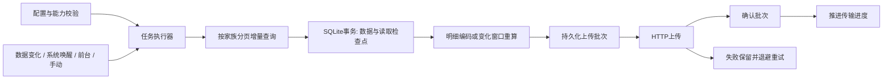

# HealthRelay：通用 Apple Health 自动化配置引擎

2026-10-12。整体设计；自动化配置 App 第一阶段已实现，健康数据执行链路尚未接入。当前状态见 [阶段说明](implementation-configuration.md)。

## 1. 产品定义

用户可以创建任意支持类型的健康数据任务。一次配置回答六个问题：读什么、从哪里读、读哪个范围、如何处理、何时执行、发到哪里。App 把配置可靠执行，并展示系统限制和运行结果。

不是为 HRV、心率或飞书签名单独做上传 App。步数、营养、体重、呼吸、睡眠、症状等都是目录中的条目。测试可以从少量有真实数据的指标开始，产品模型必须通用。

HEA 是功能参照；公开说明、实机观察与自主设计是依据。未验证的 HEA 内部算法不是既定事实。

## 2. 可配置能力

| 区域 | 内容 | 约束 |
| --- | --- | --- |
| 任务 | 名称、启停、复制、删除、预览、手动运行 | 导入默认禁用，复制生成新 ID |
| 数据 | 搜索、分类、多选指标、数据家族 | 仅开放目录已实现且当前系统可用的类型 |
| 来源 | 每指标多选包含，任务全局排除 | 包含不是来源排名，排除优先 |
| 单位 | 每指标输出单位，全局默认单位 | 校验量纲；改变输出不改变样本身份 |
| 日期 | 增量、今天、昨天、过去 N 天、自定义 | 日历范围有时区，增量使用变更游标 |
| 处理 | 明细/汇总、分钟/小时/天、统计方法 | 不适用组合同时在 UI 与导入时拒绝 |
| 接口 | URL、POST、普通 headers、凭据引用、超时 | 第一版通用 HTTP，认证存 Keychain |
| 执行 | 数据变化、最小间隔、前台补跑、手动、快捷指令 | 不承诺后台准点运行 |
| 传输 | 批次、重试、确认模式 | 以批次确认，不以开始时间表示成功 |
| 日志 | 查询/缓存/上传阶段、耗时、范围、计数 | 分清空结果、等待解锁、错误和确认 |
| 提醒 | 缓存更新/运行结果通知、打开 App 的定时提醒 | 通知与运行调度分离，默认避免每次成功都通知 |
| 配置文件 | 版本化 JSON 导入导出、差异预览 | 不含健康样本、运行游标和真实认证值 |

主页面是任务列表。详情分“数据、导出、接口、执行”；日志区分最新测量时间、读取时间和上传时间，不把它们合成一个“同步时间”。

## 3. Swift 为主，Go 可选

计划 Swift 6 + SwiftUI，最低 iOS 18；使用最新 Xcode SDK 构建，新增类型独立进行 availability 检查。RMSSD 是 iOS 27 新数量类型的一个例子，不是项目的业务范围。

HealthKit 负责权限、来源、样本、统计和变更。SQLite 使用系统库，保存任务、anchor、变化窗口、待上传批次与日志；先不引入 ORM。Keychain 保存凭据。URLSession 做文件式后台上传，BackgroundTasks 做系统允许的补跑，AppIntents 调用同一执行器。

第一阶段只开发 App，直接面向用户配置的接口。Go/Docker 保留为后续可选接收组件，不作为开发或运行依赖，见 [自部署方案](self-hosting.md)。

计划目录：

```text
ios/HealthRelay/                 SwiftUI、权限、生命周期
packages/HealthRelayCore/        配置校验、记录、批次和确认
packages/HealthRelayKit/         指标目录、来源、读取器、统计
packages/HealthRelayStore/       SQLite 事务、检查点、outbox
packages/HealthRelayTransport/   URLSession、重试和确认
catalog/                        SDK 清单与能力覆盖
examples/                       合成配置和数据协议
server/                         后续 Go 参考接收服务
skills/                         后续配置生成与校验
```

配置模型、校验和文件保存已建立可测试的 Swift Package，SwiftUI 配置页与 Xcode 工程已接入。数据读取、队列、传输及服务仍为计划目录。

## 4. 指标目录：做到广泛覆盖

每项描述稳定标识符、名称、分类、数据家族、最低系统版本、读取策略、合法单位、统计能力、输出格式与验收状态。调度器和上传器不根据指标名称选择业务路由。

HealthKit 没有一个能枚举全部指标并理解所有语义的统一接口。以公开 SDK 标识符为覆盖基线，在 Swift 注册表中构建类型，并维护元数据；升级 SDK 时检查清单差异。不能仅靠标识符名称自动推断单位、枚举或汇总规则。

| 家族 | 读取 | 汇总 |
| --- | --- | --- |
| Quantity | 通用数量样本与 anchored 变更 | 按 aggregationStyle 与合法统计能力选择 |
| Category | 保留枚举值和起止时间 | 已定义的计数/时长策略，否则仅明细 |
| Correlation | 父对象及子样本关联 | 默认明细，不任意平均对象 |
| Workout | 核心记录，路线与曲线按需分页 | 保留结构，拓展数据独立读取 |
| ECG / Audiogram / Series | 专用查询与子数据分页 | 默认明细 |
| 心情 / 用药 | 对应系统版本的公开读取器 | 保留结构，不强行转换成数字 |
| Activity Summary / Characteristics | 快照读取 | 不伪造 anchored 增量 |
| Clinical / restricted | 先核对 entitlement 与接入条件 | 条件不满足不开放执行 |

目录状态为 `planned / implemented / deviceVerified`。标识符盘点不代表已经可读，更不代表所有类型都能做分钟平均。可执行任务只能选择已实现能力，缺少真实样本的类型不能标记真机验收。

目标覆盖公开 API 与设备权限允许的类型。Apple 健康 App 自己计算的部分评分或图表不一定有公开读取接口，不能承诺照搬所有显示结果。

## 5. 一个配置模型

`AutomationConfig` 是 UI、文件导入、快捷指令和 Skills 的共同模型。配置有 `schemaVersion`、稳定任务 ID 和 `revision`；运行时检查点单独存储。

“健康指标（全部）”任务可选择数量、分类与关联记录，共用一个明细配置；也能选择单独家族限制目录。汇总要求所选项有共同的已定义统计能力，数量与分类不能任意套用同一种统计；需要不同语义或粒度时拆分任务。

修改查询、来源、输出或接收端会建立新执行版本，并明确选取启动范围。仅更改显示名称不触发重读历史。已经排队的批次固定使用创建时的配置版本，避免中途把旧数据发到新地址。禁用取消未启动的发送，已开始的请求仍记录结果。

导入：解析版本 → 校验能力和字段 → 预览数据范围与目标 → 保存禁用任务 → 用户补凭据、授权并启用。相同 ID 展示差异，不静默覆盖。配置文件不携带样本、游标或任意脚本。

## 6. 执行链路



同一任务由 Swift actor 串行推进，合并重复触发。首版同时限制重型查询并发，避免多个全指标任务挤占后台预算。

### 两套进度

读取 anchor 表示“变更已经可靠保存到本机”；批次确认表示“接收端已确认”。不能使用一个 `lastRunAt` 同时代表两者。

一页结果中的记录、删除事件、anchor 与变化窗口同事务落盘。事务前退出可以重读；事务后退出从保存的进度继续。网络超时重发固定 batch ID 和固定文件，收到有效确认后才完成批次。缓存成功或请求已发出都不算上传完成。

### Since Last Sync

首次选择历史下界，后续固定 predicate 下界并使用 anchor 获取新保存/删除对象；测量时间早但后来写入的记录仍能被读取。不能每次改成“最近 30 分钟”。

anchor 绑定任务执行版本、数据类型和查询条件；重装、修改过滤条件不能直接复用旧游标。初始下界之前的数据不在增量覆盖内，需独立历史回填，并展示覆盖范围。

快照家族对指定范围重查并比较内容摘要，不承诺与 anchored 家族相同的语义。

### 分页和预算

初始默认：每页 500 个对象，上传文件最多 1 MiB；超限拆批。单个复杂对象超限使用专用子数据协议或报错，禁止静默截断。

后台即将过期时停止新查询，保留完整已落盘页与未处理窗口。Observer completion 在本地持久化完成或错误退出后调用一次，不等待网络整批成功。

outbox 警戒 50 MiB，硬上限 100 MiB，真机验证后可调整。硬上限停止读取和 anchor 推进，仍发送已有批次；未确认数据不能按普通缓存期限删除。

汇总任务只保留待处理窗口所需数据，删除/迟到变更重查相关窗口，不能为了日汇总永久复制整个 HealthKit 库。

## 7. 明细与汇总的正确性

明细保留样本 UUID、起止时间、来源、单位和类型载荷。不允许把秒级时间取整冒充分钟平均。

汇总携带 `[start,end)` 窗口、时区、统计方法、来源范围、样本数和快照版本。使用 HealthKit 统计 API 与类型 aggregationStyle；时间加权离散指标不能无条件做算术平均。

累计值、离散值、分类时长和血压关联有不同规则。没有验收汇总策略的类型仍可导出明细，但禁止错误汇总。跨来源累计样本不能简单全部相加当成 Apple 健康总数；实际来源合并语义要验收并说明。

增量汇总 = 原始变更增量读取 + 受影响窗口完整重算。昨天的迟到记录只更新相交窗口，发送替换快照；接收端不能把新快照加到旧值。跨天分类段触发全部相交窗口重算；日边界使用时区与日历，不固定为 86400 秒。

删除导致已上传非空窗口变空时，仍发送空快照/删除事件。初次空查询只记录检查结果，不反复发送空批次。

## 8. 后台限制与可解释状态

`HKObserverQuery` 与 background delivery 通知变更；`BGAppRefreshTask / BGProcessingTask` 补跑；进入前台检查待处理任务与上传回调。最小间隔用于合并触发，不做后台常驻计时器。

变化发生但尚未到最小间隔时，将待处理标志持久化，等待下一次系统/前台执行机会；不能丢弃这个通知，也不能把 nextEligibleAt 当成系统保证的唤醒时间。选择全部指标时分阶段分页推进并展示成本，不在一个后台时段内无界读取全部历史。

手动可以绕过普通间隔，不能绕过平台权限、容量或任务互斥。锁屏时 HealthKit 可能不可读，状态为 `waitingForUnlock`，保留检查点。原始缓存默认完整文件保护；已编码文件在锁屏继续上传需要单独的文件保护策略和实机验证，首版不依赖锁屏传输成立。

HealthKit 不直接告知读取权限被拒绝；空查询展示“未读到数据，可检查健康权限”，不能错误断言“拒绝授权”。

用户能看到最新测量、最近检查、缓存条数、等待上传和最后确认；这可以区分没采样、系统没调度、无法读取和接口失败。

## 9. 目的地与上传可靠性

第一版独立 `healthrelay.v1` 原生协议；自定义 URL 与普通 headers，Keychain 在运行时注入认证。首版 POST，默认 HTTPS，拒绝上传重定向；局域网开发 HTTP 单独显式配置，不全局关闭传输安全。

- `receipt`：要求 200/201、匹配 batch ID、`committed=true` 与正确计数，确认整批提交。
- `http2xx`：兼容成功状态与空响应，包括 204，但首版 202 不作为最终成功；只能说明接口接受，无法证明入库。

重试断网、超时、408、429、5xx；有抖动指数退避，Retry-After 有上限。401/403 等待修复凭据，422 显示协议错误，413 拆批保留原变更覆盖。

服务端同事务写去重批次、记录和确认。相同 ID/相同内容返回原确认，相同 ID/不同内容返回 409。手动回填和重装可能生成新批次，所以记录 UUID 去重也必需。

## 10. 现有服务与 HEA 兼容

内部标准记录与外部编码分开。HEA v2 是后续编码选项，不因既有服务只接受几个业务流而限制通用产品。

兼容必须验证实际字段、单位、日期、来源和分组；只复用 headers 不能算验收。先接测试 endpoint 对比，再关闭旧发送器并切换。旧任务在验收前保留，生产同一目标只启用一个发送器。

Go 参考接收器后续提供 `/v1/batches`、SQLite 事务幂等与查询回执。签名、Bot、HTML 渲染在接收后的下游完成，数据不变化时复用已有结果。App 首版不内置特定用户的压力算法、飞书账号或生产接口。

## 11. Skills、快捷指令、MCP

Skills 先生成与校验 JSON 配置；App 前台导入预览，用户确认健康读取和上传目标。无需把配置变成逐个点击手机页面，不能在配置中嵌入任意代码。

AppIntents 运行已有任务、查看状态、前台导入，共用执行器和游标。快捷指令不能额外保证每 N 分钟精准后台运行。

MCP 后续优先查询已上传的数据，带认证与用户隔离。手机 LAN 服务须另立前台生命周期、认证和访问范围设计，不能让它承担后台上传。

## 12. 值得优先解决的难点

1. 不同数据家族统一配置，同时保留单位、统计和结构语义。
2. 读取进度、本机事务、上传确认分离；进程退出和网络故障可恢复。
3. 迟到和删除事件增量修正汇总，不扫描全历史。
4. 后台限制可观测，准确解释等待和失败。
5. 新 SDK 类型可扩展，旧 iOS 可运行，外部协议独立版本化。

设置页面只是入口。任何 UI 可选能力都要有执行器与验收支撑。

## 13. 验收

先用有数据的数量与分类案例跑通通用路径，再对完整数量/分类目录扩大覆盖。心率、体重、营养、步数、症状、睡眠和新增系统类型都是测试矩阵，不能变成固定产品模板范围。

真机验证锁屏恢复、断网补传、系统取消、重启、首次大历史、迟到、删除、跨天和时区。日志与测试接收端计数/回执一致才算通过；模拟器不能代替 HealthKit 后台验收。

## 14. 公开依据

- [HealthKit 数据家族](https://developer.apple.com/documentation/healthkit/data-types)
- [Anchored 查询](https://developer.apple.com/documentation/healthkit/hkanchoredobjectquery)
- [Observer 与真机后台测试](https://developer.apple.com/documentation/healthkit/hkobserverquery)
- [后台最早时间不保证准点](https://developer.apple.com/documentation/backgroundtasks/bgtaskrequest/earliestbegindate)
- [读取权限和锁屏保护](https://developer.apple.com/documentation/healthkit/protecting-user-privacy)
- [HEA 数据目录](https://help.healthyapps.dev/en/health-auto-export/getting-started/supported-data/)
- [HEA REST 自动化](https://help.healthyapps.dev/en/health-auto-export/automations/rest-api/)

状态机与默认上限是本项目设计，不声称是 HEA 内部实现。
