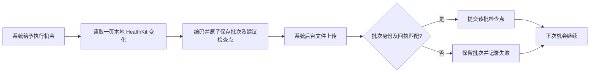

# HealthRelay Watch companion

Watch companion 最初在独立 `codex/watch-companion` 分支基于 `ea88935` 开发，现与 iPhone 自动化、定时和后台生命周期修复整合。Watch App 与 iOS App 同仓库，复用通用自动化核心；不使用 Collar_watch 的非商业许可源码。

## 解决什么问题

iPhone 锁屏后，健康数据库读取受数据保护限制。已解锁并佩戴的 Watch 可以在获得系统执行机会时读取自己本地可访问的 HealthKit 数据，直接上传配置的 HTTPS 接口，减少等待 iPhone 解锁和健康数据同步的时间。

Watch 熄屏不等同于设备锁定；摘表、重启未解锁、权限、数据是否已到达、网络、电量和 watchOS 调度仍会影响执行。Watch 本地数据不等于 iPhone 的完整健康数据库。不能承诺固定每 15 或 30 分钟上报，也不能把上传频率当作传感器采样频率。

## 目录与职责

- `ios/`：任务编辑、执行设备选择、向配对 Watch 同步配置。
- `watch/`：任务接收、健康授权、任务启停、读取及后台直传。
- `packages/HealthRelayCore/`：通用配置、指标目录、明细/汇总编码、检查点和确认协议。
- `scripts/generate_xcode_project.py`：生成同一 Xcode 项目中的 iOS / Watch target 与 scheme。

HealthKit 能力按平台 SDK 版本检查；watchOS 11 与 iOS 18 的版本数字不能直接比较。RMSSD 在 SDK 27 中声明支持 watchOS 27，但声明可用不表示所有设备都已经产生该指标，也不表示已在真机验收。

## 配置与设备分工

在 iPhone 完成任务的指标、格式、日期范围、HTTPS 接口和认证配置，选择 Watch 作为执行设备，再显式同步到配对 Watch。在 Watch 检查接口和任务，完成健康授权后启用。读取权限无法由 App 准确判断为“已经允许”；没有记录时也可能是未授权或本机没有该数据。

配置同步只传指标、规则、接口及所需认证 Header 名称；不读取或传输 iPhone Keychain 的认证值和引用。需要认证的任务在 Watch 上单独填写，保存为 Watch 本机 Keychain 引用后才能启用。普通 JSON 文件导出继续脱敏，日志不记录健康正文或认证内容。

同一个任务只由一个设备执行。迁移任务不会跨设备搬运 HealthKit anchor；Watch 会从自身的日期范围起点建立进度。服务端仍须按记录身份幂等处理。不同来源产生的步数/能量不能简单相加冒充 Apple 健康去重后的总数。

“已加入同步队列”与“Watch 已接收”是不同状态。更新/移除任务不能丢弃已经准备的未确认批次；待上传批次处理完成后才能修改其数据规则或接口。切回 iPhone 时，必须等待 Watch 停止该任务的确认，不能仅凭手机本地字段变化就双端运行。若认证失效阻塞了旧批次，可在 Watch 确认取消该批次后修正认证；取消不推进已确认游标，下次重新读取未确认数据，服务端仍可能已经收到原请求，因此必须幂等。

## 上传与确认



后台网络传输与健康数据查询分开。进程被暂停后，系统可以继续已有文件传输；新样本读取仍须等待 HealthKit 可用和系统调度。每个回调必须对应精确的任务、批次和配置，不能用一个全局“最后上传游标”确认所有请求。

后台触发采用健康变化通知、前台机会和系统刷新申请；设定间隔表示期望的最小间隔。失败批次遵循重试间隔，无变化不反复上传。回执文件暂时无法写入时，会保留内存回执并在后续机会重写；进程退出后仍保留原待确认批次，可幂等重传。用户强制退出、重新签名安装和系统资源限制均需要重新打开 App 检查状态。

### 接口必须是最终接收地址

填写直接接收 POST 的 HTTPS URL，不要使用短链、登录页面或跳转入口。Apple 的后台 URLSession 总会跟随 HTTP 重定向，重定向代理回调不会被调用。检查最终响应 URL 可以拒绝确认异常响应，但不能保证数据在重定向前未被转发。该限制与 iOS 现有普通 URLSession 的禁止重定向行为不同。

[Apple 后台传输限制](https://developer.apple.com/documentation/foundation/downloading-files-in-the-background)

## 本地验证

```sh
swift test --package-path packages/HealthRelayCore
python3 scripts/generate_xcode_project.py
xcodebuild -project ios/HealthRelay.xcodeproj -scheme HealthRelay -destination 'generic/platform=iOS Simulator' CODE_SIGNING_ALLOWED=NO build
xcodebuild -project ios/HealthRelay.xcodeproj -scheme HealthRelayWatch -destination 'generic/platform=watchOS Simulator' CODE_SIGNING_ALLOWED=NO build
```

2026-10-13 Watch 独立分支的历史验收（合并后复核见 README）：

- Core：58 项 XCTest + 19 项 Swift Testing，共 77 项通过；其中 2 项显式使用隔离 Cloudflare 接口，没有跳过。默认不提供测试配置时，这 2 项外网测试会跳过。
- 隔离接收器：5 项测试通过。
- 原生 iOS 模拟器 UI：新建通用任务、选择指标、保存与重启恢复的 1 项回归通过；长表单测试改用小步拖动，避免快速滚动越过接口输入框。
- iOS + Watch 组合构建通过，Watch scheme 独立构建通过。项目生成器重复生成结果一致。
- WatchOS 27 模拟器：本地签名后，合成 SDNN 任务经过真正的后台 URLSession 上传；日志为「后台已确认 1 条」、HTTP 200，pending 清空、检查点落盘、传输文件清理；服务端核对仅 1 条 `test.synthetic` 来源记录。重启 App 后结果为「没有可读取的新记录，无需重复上传」，原检查点保留。
- 回执丢失测试：服务端已保存后丢弃首次回执，重建客户端 journal，再发送同一批次；服务端仍只有 1 条记录，客户端收到有效回执才提交检查点；重复回调不会再次提交。

上述后台 URLSession 验收发生在模拟器前台触发之后，证明了系统传输与回执处理通道，**不证明真机自然唤醒、iPhone 锁屏时的上传频率或耗电**。WatchConnectivity 的真实双端传输与本机健康读取仍留待真机验收。

### 运行模拟器需要签名

`CODE_SIGNING_ALLOWED=NO` 适合编译检查。本轮未签名 Watch 模拟器运行时，Keychain 返回 `-34018`；改为正常本地签名后成功，没有降低凭据保护：

```sh
xcodebuild -project ios/HealthRelay.xcodeproj -scheme HealthRelayWatch \
  -destination 'generic/platform=watchOS Simulator' \
  CODE_SIGNING_ALLOWED=YES CODE_SIGN_IDENTITY=- build
```

双平台组合构建不要全局传入 `-sdk iphonesimulator`，它会覆盖 Watch 依赖的 SDK 并导致 Swift 包平台冲突。使用上面的 destination 即可。

合成运行入口只在 `DEBUG && targetEnvironment(simulator)` 下存在：在专用模拟器 App 的 `Documents/acceptance-fixture.json` 放入 `{configuration, credentials}`，再带 `--watch-synthetic-acceptance` 启动。配置须使用隔离 `healthrelay-acceptance.*.workers.dev/ingest`；新配置、已加载配置和每次运行均检查该边界。认证经模拟器本机 Keychain 保存后，文件会删除。不要在 Git 中放测试认证或模拟器容器内容。

## 合并时补齐的后台生命周期

合并 iPhone 自动化分支时，原生 Watch 回归复现了三个问题：启动回调结束时尚未注册 Observer、健康回调在串行队列仍忙时提前完成、文件暂不可读后无法自行恢复。

现于 `applicationDidFinishLaunching` 同步注册 Observer，再异步配置后台交付；健康回调复用两端共享的 `ObserverWork`，等待处理结束或 15 秒到期，取消并申请后续机会后恰好完成一次。Watch 系统刷新到期也会安排恢复；任务运行期间保留后续刷新申请。

配置、配置接收回执与 journal 全部加载成功后才发布状态。读取权限暂不可用时保留原文件并等待；后续前台、后台执行或配置接收机会会重读。读取仍受保护时会申请至少 5 分钟后的刷新，避免消耗最后一次机会；不会执行历史扫描。解码或版本错误仍停止执行，不静默清空配置。这不代表解锁一定立即唤醒进程。

新增 `HealthRelayWatchTests` 原生测试目标，使用独立临时目录、真实文件读写及权限变化验证恢复；同一套有界回调测试在 iOS 和 watchOS 执行。模拟器文件权限恢复不等于真实 Watch 锁屏验收，最新测试结果见 README。

## 后续真机验收

仅使用独立 Cloudflare 测试接口，任务与数据空间均与生产隔离：

1. 从 iPhone 同步包含心率、SDNN、RMSSD 和睡眠的测试任务，核对 Watch 接收状态与不支持项提示。
2. 手动运行，核对源样本 UUID、来源、时间、单位及服务端确认，不仅检查 HTTP 200。
3. 手机锁屏、Watch 佩戴解锁，记录自然数据产生、后台唤醒和服务器接收的各自时间。
4. 断网、恢复网络、重启 App，确认同一批次重试不会重复入库，游标不会跳过未确认记录。
5. 测试配置更新/删除、两端切换以及延迟到达的旧回执。
6. 观察至少一个日夜周期的电量和实际上传延迟。模拟器和编译成功不能替代这些结果。
