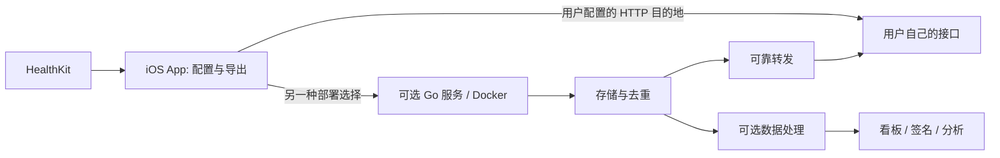

# App 导出与可选自部署服务

2026-10-12，方案阶段；本文不是已经可运行的部署说明。

## 1. 职责边界

HealthKit 提供应用获准读取的数据类型与记录；App 按用户配置读取、过滤、转换单位、选择明细或汇总，并编码上传。App 不产生新传感器测量，也不将本项目指标目录当成独立健康数据源。

配置能力以 HEA 为功能对照，逐项验收；不只复刻界面。对照包括数据选择、来源、单位、日期范围、汇总与分组、目的地与 headers、导出格式版本、启停/复制、手动运行、通知、日志和自动化入口。HEA 自身的配置文件兼容与输出格式兼容分别验收，不能混为一项。

HealthKit 提供的是有类型的对象，不是一个可以直接 POST 的统一 JSON。这里的“原始数据”指样本明细语义：保留类型、UUID、起止时间、值/类别、单位、来源以及被选择的公开元数据，再序列化为协议。不能承诺一个 JSON 包含 HealthKit 全部内部状态或不受限制的元数据。

用户选择明细时不自动添加压力评分等派生结果；选择汇总时 App 按配置完成合法统计。服务端能够基于收到的数据继续处理，但已经汇总后的载荷无法恢复丢失的明细。

## 2. 两种使用路径

两条路径由任务的目的地选择决定，不默认将同一数据同时发给两个服务。

### 直接上传

用户配置完整 URL、认证、headers、导出模式与格式。App 负责本机重试与批次进度，接收端自行实现存储与处理。使用本项目服务不是前提；原生协议和经过验收的 HEA 兼容编码各有明确范围。

### 可选自部署

用户在 Mac、NAS、Linux 主机或 VPS 运行 Go 服务。它作为任务的目的地，负责接收确认、存储去重、处理和转发。Docker 只打包这项服务，不读取手机的 HealthKit，也不运行 iOS App。

首个自部署版本使用一个 Go 容器与 SQLite 持久化卷，不引入 Redis、消息队列或独立数据库容器。提供镜像、Dockerfile、Compose、配置例子与健康检查；待接收服务完成验收后再发布可执行部署文件，当前不发布指向不存在程序的 Compose。

手机连接宿主机的可达地址。手机中的 localhost 是手机本身，不是 Mac。只有局域网地址时，离开该网络应排队等待可达；需要异地同步时由用户提供可达的 HTTPS 地址或其自选隧道。

## 3. Go 服务的首版能力

| 能力 | 职责 |
| --- | --- |
| 接收 | 校验格式、认证、批次大小，返回明确确认 |
| 去重 | batch ID/body 摘要去重；样本 UUID 去重 |
| 存储 | 接收的明细/快照与处理结果分开，SQLite 卷持久化 |
| 转发 | URL 与认证配置独立，待转发批次持久化，失败重试 |
| 处理 | 确定性统计、趋势与其他用户选择的处理器 |
| 可观测 | 最后收到、最新测量、接收数量、转发积压与错误 |

首个端到端版本先交付接收、确认、去重和可靠转发。看板、签名、AI 分析按后续需求接入，AI 和 LLM API key 不是启动接收服务的条件。

App 配置导出的粒度与输出协议；服务端配置转发目标和处理规则。一个用户选择“明细直传”时，服务端不能悄悄改成日汇总。

## 4. 确认与转发的关系

服务端完成校验、在同一事务保存接收批次和待转发任务后，才返回 `committed=true`。这个确认表示本地服务已接管数据，不表示所有下游均已送达。

转发失败由服务端重试；App 不因下游故障重新扫描健康历史。各下游目标有独立投递状态、稳定幂等键和错误记录。下游不支持幂等时仍可能收到重复请求，不能承诺全链路 exactly-once。

成功转发前不能按普通过期清理规则删除队列载荷。即使选择只转发不长期保存，也需要临时持久化批次，保证容器重启后继续发送。存储额度满时拒绝接收新批次，让手机保留数据重试，不返回虚假的成功。

## 5. 参考 HiMe 的部分

当前 HiMe 的 Docker Compose 分为 backend、frontend、watch exporter，并为数据、记忆和其他状态挂载持久化目录。其 Watch Exporter 接收代码使用 SQLite；其完整产品还包括 AI 分析与聊天等能力。

本项目参考可自部署、客户端独立读取、接收数据持久化和下游处理的边界。保持自主实现；第一版采用更小的 Go 接收服务，后续分析可以接 HiMe 或其他服务，但接入协议需要独立验证。

公开依据：

- [HiMe Features](https://github.com/thinkwee/HiMe#features)
- [HiMe Compose](https://github.com/thinkwee/HiMe/blob/main/docker-compose.yml)
- [HiMe 部署说明](https://github.com/thinkwee/HiMe/blob/main/docs/DEPLOYMENT.md)
- [HiMe 接收代码](https://github.com/thinkwee/HiMe/blob/main/ios/Server/server.py)
- [HealthKit 样本对象](https://developer.apple.com/documentation/healthkit/hksample)
- [HEA 自动化能力](https://help.healthyapps.dev/en/health-auto-export/automations/)

## 6. 接下来实施顺序

先固定 App 通用配置和明细协议，再建立 Go 测试接收器与 Docker 打包，用这条链路验收 App 的读取、补传、去重和确认。Go 服务随后补可靠转发。汇总、复杂数据家族、HEA 编码兼容和下游分析继续分阶段扩展。

首版发布条件：真机生成任务 → 读取并上传 → Docker 服务持久化并确认 → 重复发送不重复入库 → 容器重启继续转发 → 日志可核对。仅有容器健康检查通过不是验收。
